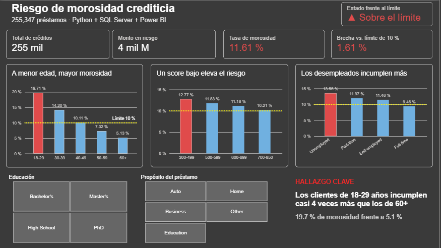
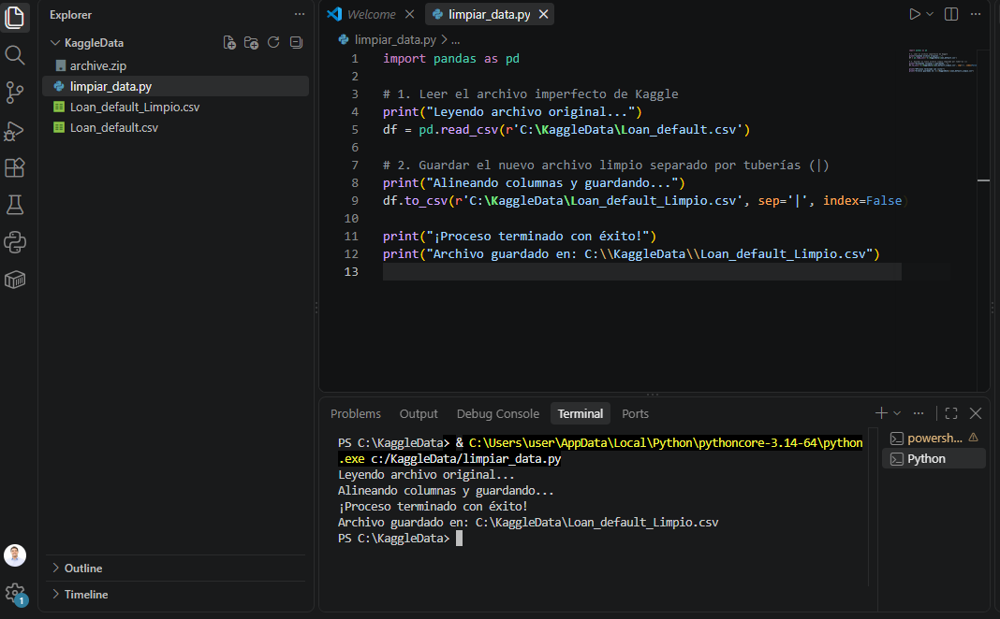
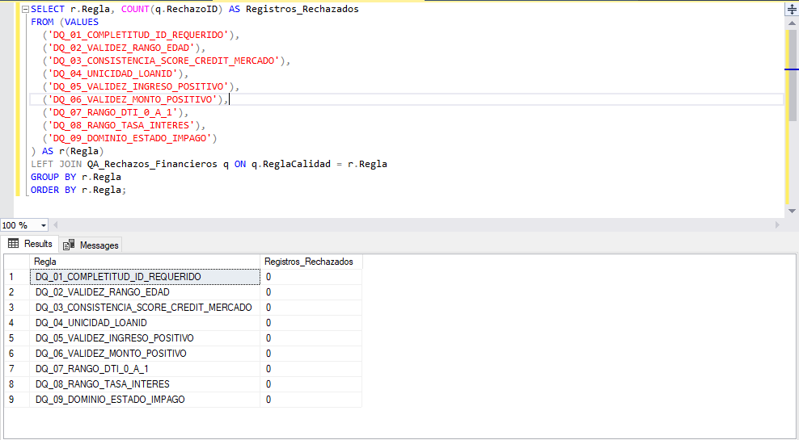
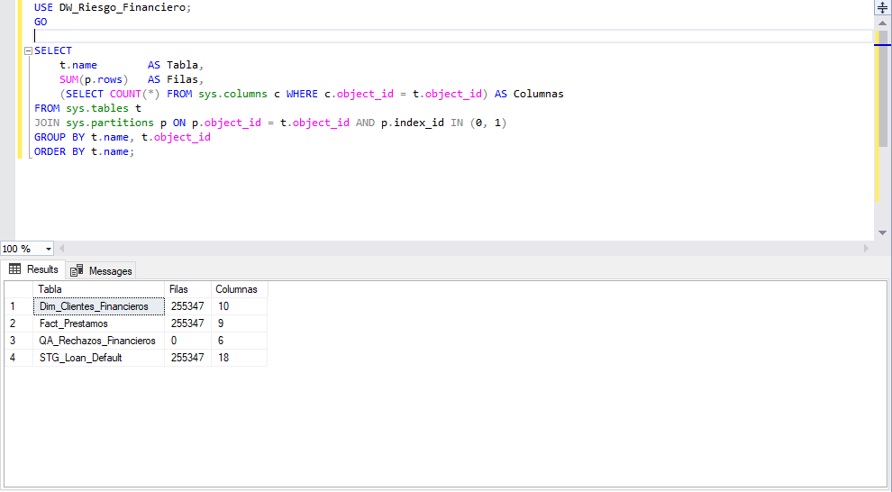
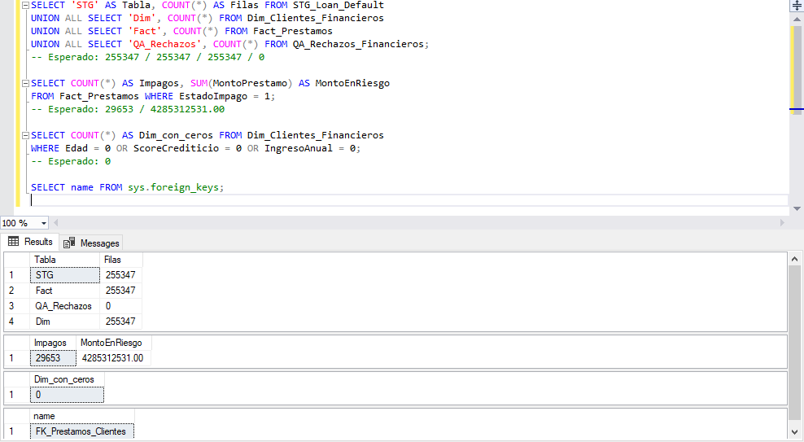
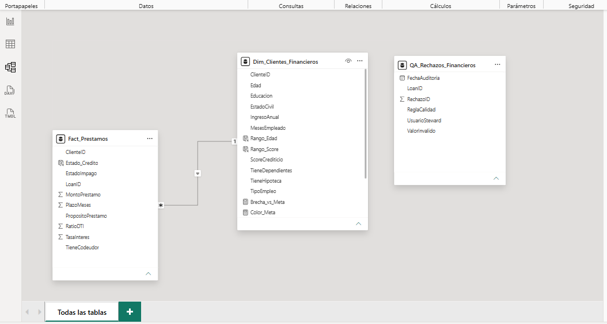
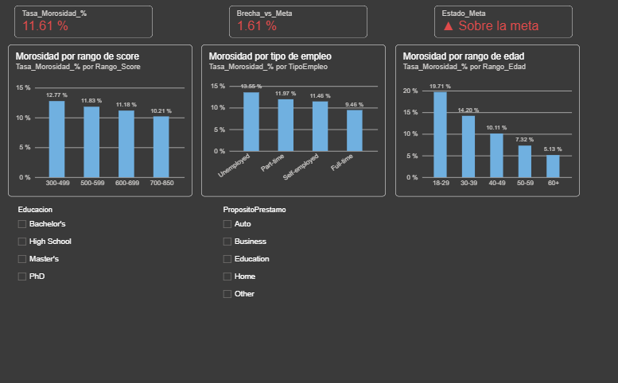

# Calidad de datos y dashboard de riesgo financiero

Proyecto de portafolio que lleva un dataset público de préstamos de Kaggle desde el CSV original hasta un dashboard en Power BI, pasando por limpieza en Python y un Data Warehouse en SQL Server con reglas de calidad de datos.

**Resultado:** 255,347 préstamos cargados sin pérdida de filas, una tasa de morosidad de **11.61 %** y **4,285 millones** en monto de préstamos en impago.



## Datos

- **Fuente:** dataset *Loan Default* de Kaggle (`Loan_default.csv`). [Ver dataset en Kaggle](https://www.kaggle.com/datasets/nikhil1e9/loan-default).
- **Tamaño:** 255,347 filas y 18 columnas.
- **Licencia del dataset:** CC0 1.0 (dominio público). Autor en Kaggle: `nikhil1e9`.
- El CSV no está en este repositorio por su tamaño (se descarga desde Kaggle). El archivo `.pbix` sí incluye los datos importados.
- Los valores de las categorías (por ejemplo `Unemployed` o `Bachelor's`) se muestran en inglés, tal como vienen en el dataset. El dataset tampoco indica la moneda del monto.
- Es un dataset público: la fuente no detalla de qué entidad provienen los préstamos, por lo que los resultados describen este conjunto de datos y no a una institución específica.

## Flujo del proyecto

```
Loan_default.csv ──► Python (pandas) ──► SQL Server ──► Power BI
                     limpieza y          staging, DW      medidas DAX
                     separador |         y reglas DQ      y dashboard
```

### 1. Python: limpieza del archivo
`python/limpiar_data.py` lee el CSV original con pandas y lo guarda con `|` como separador. Así se evita el desajuste de columnas (*schema mismatch*) al cargarlo en SQL Server.



### 2. SQL Server: staging, Data Warehouse y calidad de datos
`sql/script_sql.sql` crea la base `DW_Riesgo_Financiero` con cuatro tablas:

| Tabla | Rol | Filas |
|---|---|---|
| `STG_Loan_Default` | Staging, espejo del CSV (18 columnas) | 255,347 |
| `Dim_Clientes_Financieros` | Dimensión de clientes | 255,347 |
| `Fact_Prestamos` | Hechos de préstamos | 255,347 |
| `QA_Rechazos_Financieros` | Registro de registros rechazados | 0 |

Pasos del script:

1. Carga masiva del CSV con `BULK INSERT`.
2. Nueve reglas de calidad de datos, con los rechazos registrados en `QA_Rechazos_Financieros`:
   - `DQ_01`: completitud del identificador del préstamo.
   - `DQ_02`: edad entre 18 y 75 años.
   - `DQ_03`: score crediticio entre 300 y 850.
   - `DQ_04`: unicidad de `LoanID`.
   - `DQ_05`: ingreso numérico y mayor a 0.
   - `DQ_06`: monto del préstamo numérico y mayor a 0.
   - `DQ_07`: ratio deuda/ingreso (DTI) entre 0 y 1.
   - `DQ_08`: tasa de interés entre 0 y 50 %.
   - `DQ_09`: estado de impago solo puede ser 0 o 1.
3. Transformación con `TRY_CAST`, `TRIM` y conversión de Yes/No a bit, y carga a la dimensión y a la tabla de hechos.
4. Llave foránea `FK_Prestamos_Clientes` entre hechos y dimensión.

Las nueve reglas dieron **0 rechazos**: el dataset ya viene limpio en los campos validados. El registro de calidad queda listo para detectar problemas si se cargan datos nuevos.





### 3. Power BI: modelo y dashboard
`powerbi/dashboard_riesgo_financiero.pbix` importa las tres tablas del DW. La relación es de varios a uno (`Fact_Prestamos[ClienteID]` hacia `Dim_Clientes_Financieros[ClienteID]`) con filtro cruzado único.



Medidas DAX:

```dax
Total_Creditos = COUNT(Fact_Prestamos[LoanID])

Monto_En_Riesgo =
CALCULATE(SUM(Fact_Prestamos[MontoPrestamo]), Fact_Prestamos[EstadoImpago] = TRUE)

Tasa_Morosidad_% =
DIVIDE(
    CALCULATE(COUNT(Fact_Prestamos[LoanID]), Fact_Prestamos[EstadoImpago] = TRUE),
    [Total_Creditos],
    0
)

Meta_Morosidad = 0.10

Brecha_vs_Meta = [Tasa_Morosidad_%] - [Meta_Morosidad]

Estado_Meta =
IF([Tasa_Morosidad_%] > [Meta_Morosidad], "▲ Sobre el límite", "▼ Dentro del límite")

Color_Meta =
IF([Tasa_Morosidad_%] > [Meta_Morosidad], "#E04B4B", "#2E9E5B")
```

El 10 % es un límite de referencia definido para este análisis (no viene en el dataset). Medidas y columnas conservan el nombre `Meta` por compatibilidad, pero en el dashboard se presentan como **límite**.

Columnas calculadas para segmentar:

```dax
Rango_Score =
SWITCH(
    TRUE(),
    Dim_Clientes_Financieros[ScoreCrediticio] < 500, "300-499",
    Dim_Clientes_Financieros[ScoreCrediticio] < 600, "500-599",
    Dim_Clientes_Financieros[ScoreCrediticio] < 700, "600-699",
    "700-850"
)

Rango_Edad =
SWITCH(
    TRUE(),
    Dim_Clientes_Financieros[Edad] < 30, "18-29",
    Dim_Clientes_Financieros[Edad] < 40, "30-39",
    Dim_Clientes_Financieros[Edad] < 50, "40-49",
    Dim_Clientes_Financieros[Edad] < 60, "50-59",
    "60+"
)

Estado_Credito = IF(Fact_Prestamos[EstadoImpago] = TRUE, "Impago", "Pagó")
```

El dashboard tiene dos páginas. El dataset no incluye fechas, así que el análisis se hace por segmentos y no por evolución en el tiempo. Los colores tienen un significado fijo: **rojo** es el grupo de mayor riesgo o lo que supera el límite del 10 %, **verde** es lo que queda bajo el límite y **azul** es neutro.

- **Resumen:** tarjetas con el total de créditos, el monto en riesgo, la tasa de morosidad, la brecha frente al límite del 10 % y el estado frente al límite; tres gráficos (edad, score y tipo de empleo) con la línea del límite y la barra de mayor riesgo en rojo; filtros por nivel educativo y propósito del préstamo; y un cuadro con el hallazgo clave.
- **Detalle:** una matriz de calor de morosidad por edad y score crediticio, un gráfico de anillo con la proporción de créditos pagados e impagos, y los gráficos por propósito del préstamo y por nivel educativo.




## Cifras de control

| Indicador | Valor |
|---|---|
| Total de créditos | 255,347 |
| Créditos en impago | 29,653 |
| Tasa de morosidad | 11.61 % |
| Monto en riesgo | 4,285,312,531 |

Los números se verificaron entre el CSV original, SQL Server y Power BI.

## Hallazgos

Tasa de morosidad por propósito del préstamo:

| Propósito | Préstamos | Impagos | Morosidad |
|---|---|---|---|
| Business | 51,298 | 6,323 | 12.33 % |
| Auto | 50,844 | 6,041 | 11.88 % |
| Education | 51,005 | 6,038 | 11.84 % |
| Other | 50,914 | 6,002 | 11.79 % |
| Home | 51,286 | 5,249 | 10.23 % |

Tasa de morosidad por tipo de empleo:

| Tipo de empleo | Préstamos | Morosidad |
|---|---|---|
| Unemployed | 63,824 | 13.55 % |
| Part-time | 64,161 | 11.97 % |
| Self-employed | 63,706 | 11.46 % |
| Full-time | 63,656 | 9.46 % |

Tasa de morosidad por rango de score crediticio:

| Rango de score | Créditos | Impagos | Morosidad |
|---|---|---|---|
| 300-499 | 93,029 | 11,883 | 12.77 % |
| 500-599 | 46,454 | 5,494 | 11.83 % |
| 600-699 | 46,434 | 5,190 | 11.18 % |
| 700-850 | 69,430 | 7,086 | 10.21 % |

Tasa de morosidad por rango de edad:

| Rango de edad | Créditos | Impagos | Morosidad |
|---|---|---|---|
| 18-29 | 58,623 | 11,556 | 19.71 % |
| 30-39 | 49,491 | 7,026 | 14.20 % |
| 40-49 | 49,110 | 4,964 | 10.11 % |
| 50-59 | 49,149 | 3,596 | 7.32 % |
| 60+ | 48,974 | 2,511 | 5.13 % |

Tasa de morosidad por nivel educativo:

| Nivel educativo | Créditos | Impagos | Morosidad |
|---|---|---|---|
| High School | 63,903 | 8,230 | 12.88 % |
| Bachelor's | 64,366 | 7,789 | 12.10 % |
| Master's | 63,541 | 6,908 | 10.87 % |
| PhD | 63,537 | 6,726 | 10.59 % |

- La **edad** es la variable que más separa el riesgo: los clientes de 18-29 años incumplen casi 4 veces más que los de 60+ (19.71 % frente a 5.13 %), una diferencia de unos 14.6 puntos.
- Al cruzar edad y score, el peor grupo (18-29 años con score 300-499) llega a **21.55 %** y el mejor (60+ años con score 700-850) baja a **4.40 %**.
- Los clientes **desempleados** tienen la morosidad más alta por tipo de empleo (13.55 %), unos 4 puntos por encima de quienes tienen empleo a tiempo completo (9.46 %).
- La morosidad baja a medida que sube el **score crediticio** (de 12.77 % a 10.21 %) y el **nivel educativo** (de 12.88 % a 10.59 %), pero las diferencias son moderadas, de unos 2 a 2.6 puntos.
- Por **propósito** la diferencia es la menor: Business es el más riesgoso (12.33 %) y Home el menos (10.23 %).
- Todos los propósitos y niveles educativos quedan por encima del límite de referencia del 10 %.
- Son asociaciones observadas en este dataset, no relaciones de causa y efecto.

Las consultas que generan estas tablas están al final de `sql/script_sql.sql`.

## Cómo reproducirlo

1. Descargar `Loan_default.csv` desde Kaggle y colocarlo en una carpeta `csv/` dentro del proyecto (por ejemplo, `C:\KaggleData\csv\`).
2. Desde la raíz del proyecto, ejecutar `python python/limpiar_data.py` para generar `Loan_default_Limpio.csv` en la misma carpeta.
3. Ejecutar `sql/script_sql.sql` en SQL Server Management Studio. La ruta del `BULK INSERT` asume `C:\KaggleData\csv\`; ajústala si usas otra. El script elimina y vuelve a crear la base `DW_Riesgo_Financiero`, así que puede repetirse sin errores.
4. Abrir `powerbi/dashboard_riesgo_financiero.pbix` en Power BI Desktop y actualizar el origen de datos hacia tu servidor local.

## Herramientas

Python (pandas) · SQL Server y SSMS · T-SQL · Power BI y DAX · Git y GitHub

## Autor

**Erick Otoya**, Lima, Perú.

[LinkedIn](https://www.linkedin.com/in/erick-otoya/) · [GitHub](https://github.com/Erick2511xd)